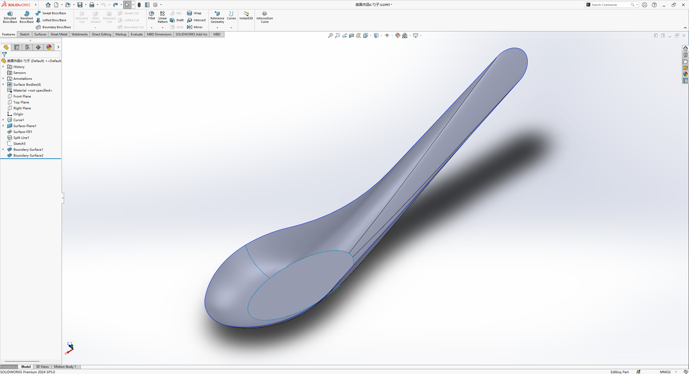
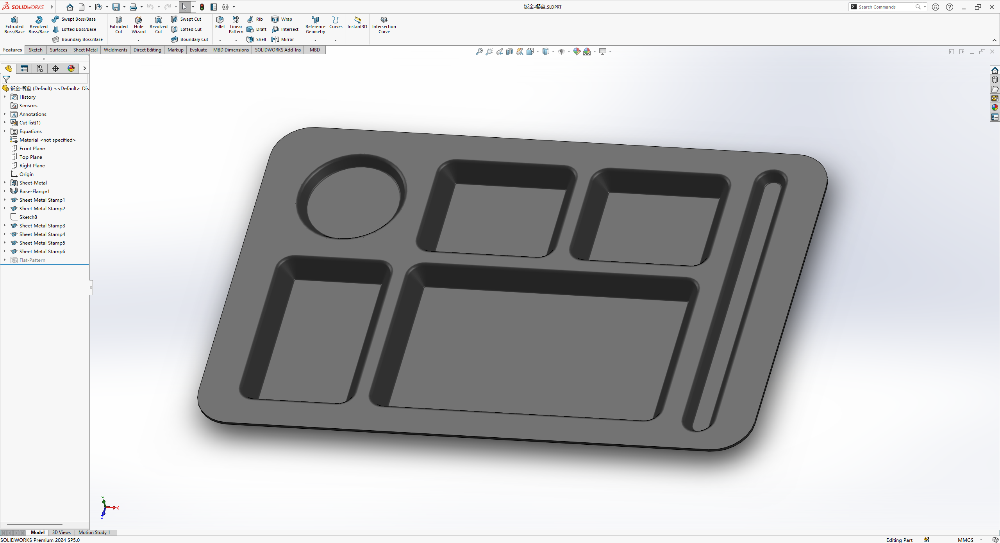
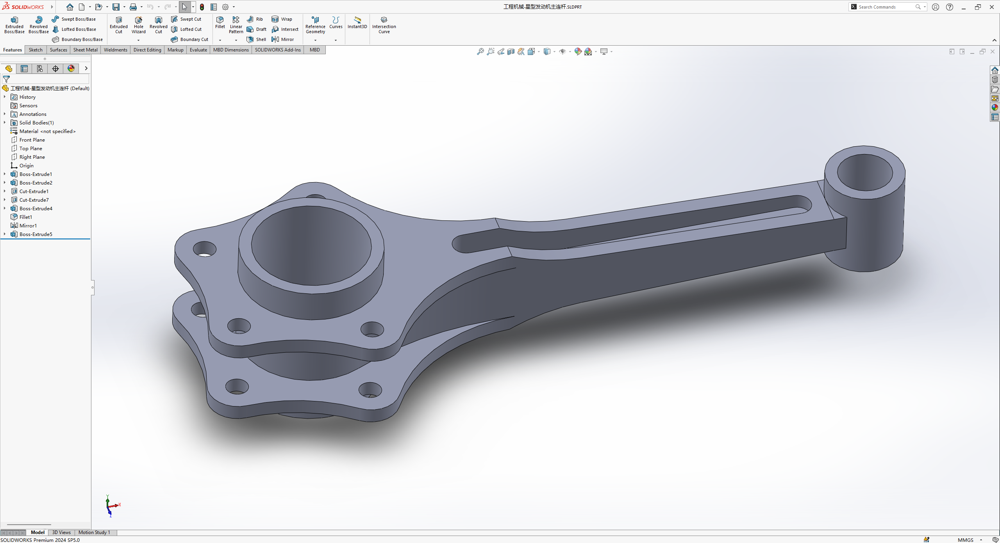
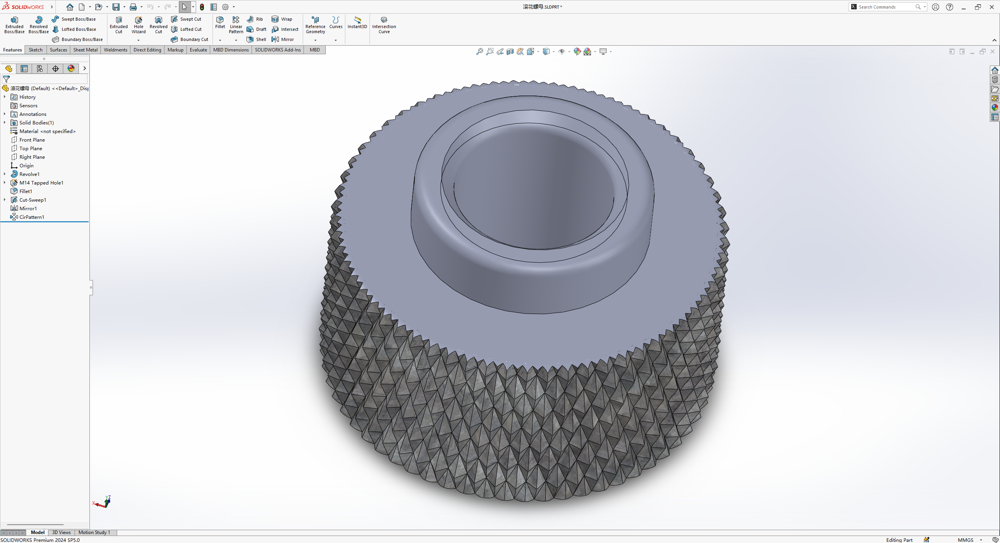
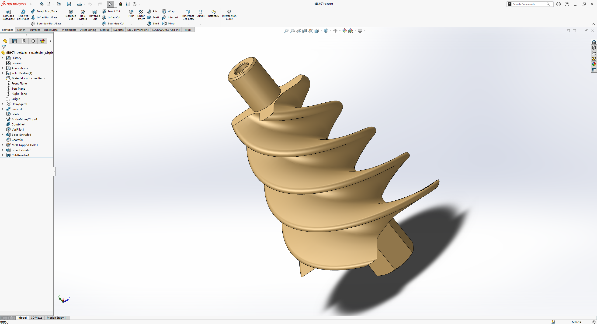
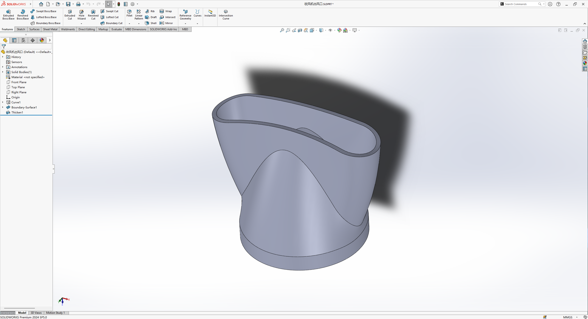
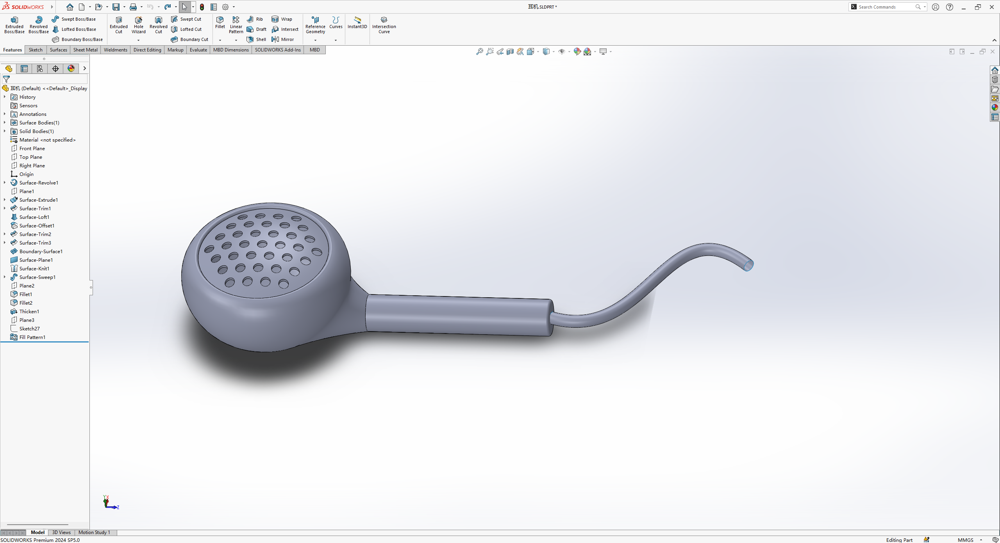
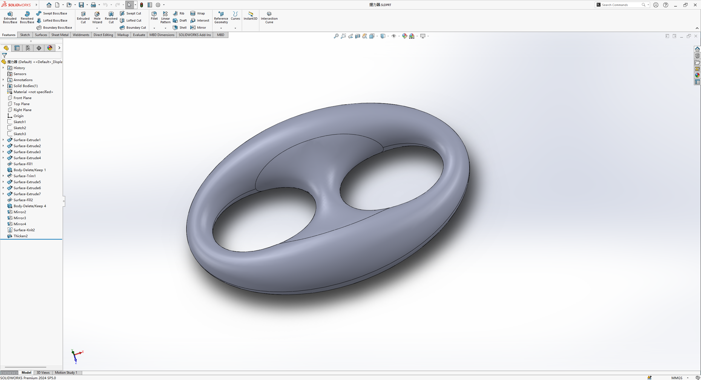
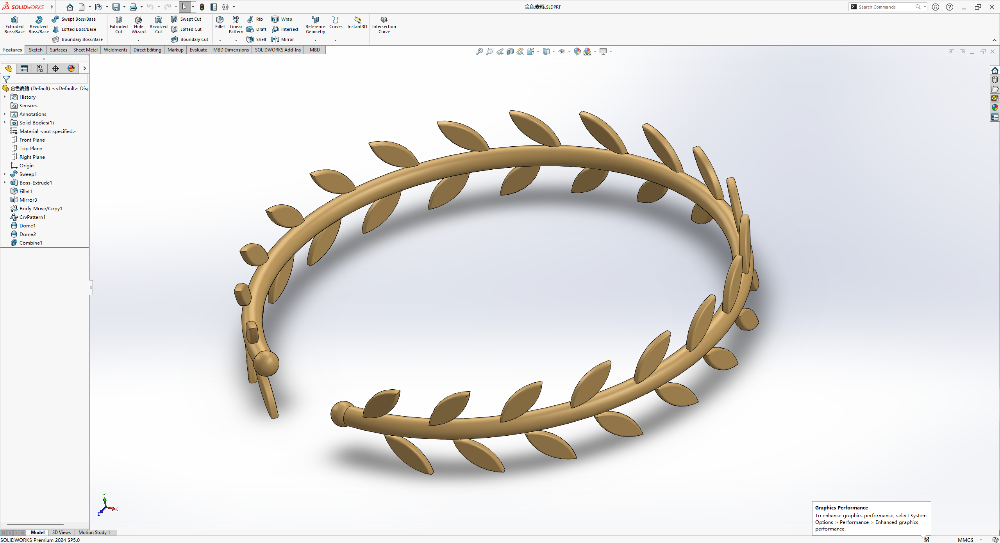
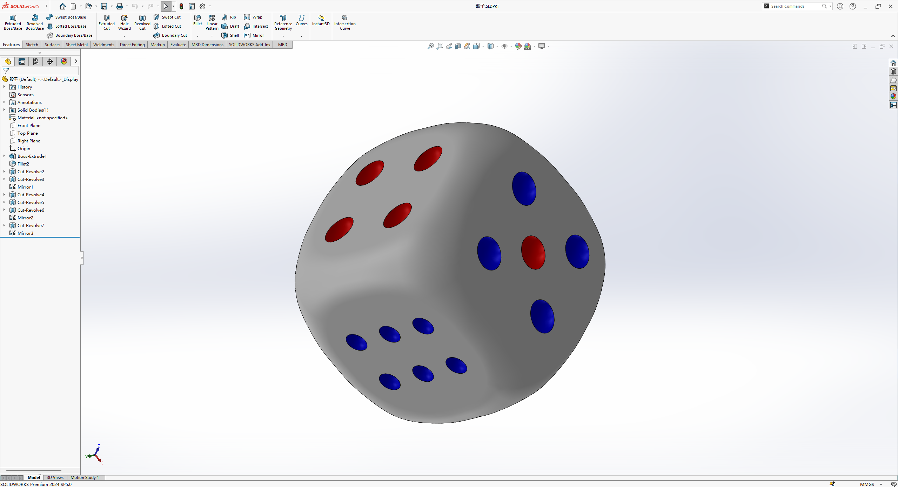

# solidworks-作品集

用于简历上证明拥有相关绘图能力的练习作品，也分享给各位用作交流学习。

使用 **SolidWorks 2024** 版本建模，下载后直接打开即可。

更改记录见 [更新日志](./CHANGELOG.md)。

## 目录结构

- 根目录：各零件作品（`.SLDPRT`），按「类别前缀-模型名」统一命名
- `预览图/`：各零件对应的模型预览图（`.PNG`），与根目录零件**同名一一对应**
- `溜溜球项目/`：完整装配体项目，包含总装配体（SLDASM）、全部零件（SLDPRT）、总工程图（DWG）、BOM 表、实物图与零件 STEP 版本
- `该目录下的SW跨版本兼容模型/`：全部零件的 **STEP 通用格式**，与源文件同名对应，低版本 SolidWorks 或其他三维软件也能打开
- `tools/generate_gallery.py`：扫描 `预览图/` 自动重建下方作品画廊的生成脚本

## 作品预览

每个模型均附一张预览图，按类别分组展示；点击图下文件名可跳转至对应零件。

<!-- GALLERY:START -->

### 曲面造型 · 9 项

| :--: | :--: | :--: |
|  [曲面造型-五彩斑斓篮.SLDPRT](./曲面造型-五彩斑斓篮.SLDPRT) |  [曲面造型-作品1.SLDPRT](./曲面造型-作品1.SLDPRT) |  [曲面造型-作品2.SLDPRT](./曲面造型-作品2.SLDPRT) |
|  [曲面造型-作品3.SLDPRT](./曲面造型-作品3.SLDPRT) |  [曲面造型-作品4-扭曲摆件.SLDPRT](./曲面造型-作品4-扭曲摆件.SLDPRT) |  [曲面造型-作品5-游戏币.SLDPRT](./曲面造型-作品5-游戏币.SLDPRT) |
|  [曲面造型-作品6-勺子.SLDPRT](./曲面造型-作品6-勺子.SLDPRT) |  [曲面造型-瓜子.SLDPRT](./曲面造型-瓜子.SLDPRT) |  [曲面造型-麦克风网球.SLDPRT](./曲面造型-麦克风网球.SLDPRT) |

### 钣金件 · 3 项

| :--: | :--: | :--: |
|  [钣金件-练习1.SLDPRT](./钣金件-练习1.SLDPRT) |  [钣金件-练习2.SLDPRT](./钣金件-练习2.SLDPRT) |  [钣金件-餐盘.SLDPRT](./钣金件-餐盘.SLDPRT) |

### 工程机械 · 2 项

| :--: | :--: | :--: |
|  [工程机械-丝锥.SLDPRT](./工程机械-丝锥.SLDPRT) |  [工程机械-星型发动机主连杆.SLDPRT](./工程机械-星型发动机主连杆.SLDPRT) |  |

### 五金件 · 3 项

| :--: | :--: | :--: |
|  [五金件-啤酒瓶盖.SLDPRT](./五金件-啤酒瓶盖.SLDPRT) |  [五金件-滚花螺母.SLDPRT](./五金件-滚花螺母.SLDPRT) |  [五金件-螺旋刀.SLDPRT](./五金件-螺旋刀.SLDPRT) |

### 家电数码 · 4 项

| :--: | :--: | :--: |
|  [家电数码-吹风机出风口.SLDPRT](./家电数码-吹风机出风口.SLDPRT) |  [家电数码-灯泡.SLDPRT](./家电数码-灯泡.SLDPRT) |  [家电数码-耳机.SLDPRT](./家电数码-耳机.SLDPRT) |
|  [家电数码-风扇.SLDPRT](./家电数码-风扇.SLDPRT) |  |  |

### 生活文创 · 4 项

| :--: | :--: | :--: |
|  [生活文创-握力器.SLDPRT](./生活文创-握力器.SLDPRT) |  [生活文创-烟灰缸.SLDPRT](./生活文创-烟灰缸.SLDPRT) |  [生活文创-金色麦箍.SLDPRT](./生活文创-金色麦箍.SLDPRT) |
|  [生活文创-骰子.SLDPRT](./生活文创-骰子.SLDPRT) |  |  |

<!-- GALLERY:END -->

## 命名规范

根目录零件、预览图与其 STEP 兼容文件均采用 `类别前缀-模型名.扩展名` 格式，前缀取自以下受控词表：

| 前缀 | 适用范围 |
| --- | --- |
| `曲面造型-` | 自由曲面与造型练习 |
| `钣金件-` | 钣金成形件 |
| `工程机械-` | 机构与装备类零件 |
| `五金件-` | 标准件与金属制品 |
| `家电数码-` | 家电与消费电子外观件 |
| `生活文创-` | 日用品、玩具与文创件 |

`溜溜球项目/` 为独立装配体项目，其内部文件沿用项目内命名，不套用上述前缀。

## 说明

- SLDPRT/SLDASM 以 SolidWorks 2024 保存，低版本软件请使用 STEP 格式打开
- 补充新预览图后，在仓库根目录执行 `python tools/generate_gallery.py` 即可一键重建画廊
