# solidworks-作品集

用于简历上证明拥有相关绘图能力的练习作品，也分享给各位用作交流学习。

使用 **SolidWorks 2024** 版本建模，下载后直接打开即可。

更改记录见 [更新日志](./CHANGELOG.md)。

## 目录结构

- 根目录：各零件作品（`.SLDPRT`），按「类别前缀-模型名」统一命名
- `预览图/`：各零件对应的模型预览图（`.PNG`），与根目录零件**同名一一对应**
- `溜溜球项目/`：完整装配体项目，包含总装配体（SLDASM）、全部零件（SLDPRT）、总工程图（DWG）、BOM 表、实物图与零件 STEP 版本
- `该目录下的SW跨版本兼容模型/`：全部零件的 **STEP 通用格式**，与源文件同名对应，低版本 SolidWorks 或其他三维软件也能打开
- `tools/generate_gallery.py`：扫描 `预览图/` 自动重建下方作品目录表的生成脚本

## 作品预览

全部作品以单一目录表汇总，按类别顺序纵向排列、各列居中对齐；点击预览图或名称可跳转至对应源文件，每条同时提供 `.SLDPRT` 与 `.STEP` 两种格式。

<!-- GALLERY:START -->

共 **25** 项作品，按类别顺序纵向排列，向下滚动即可浏览全部内容。

| 序号 | 预览图 | 作品名称 | 类别 | 源文件下载 |
|:---:|:---:|:---:|:---:|:---:|
| 01 | <a href="./曲面造型-五彩斑斓篮.SLDPRT">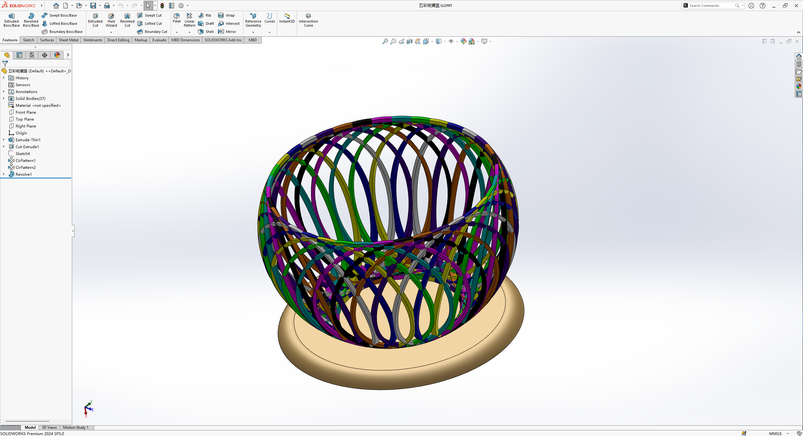</a> | **曲面造型-五彩斑斓篮** | 曲面造型 | [SLDPRT](./曲面造型-五彩斑斓篮.SLDPRT) [STEP](./该目录下的SW跨版本兼容模型/曲面造型-五彩斑斓篮.STEP) |
| 02 | <a href="./曲面造型-作品1.SLDPRT">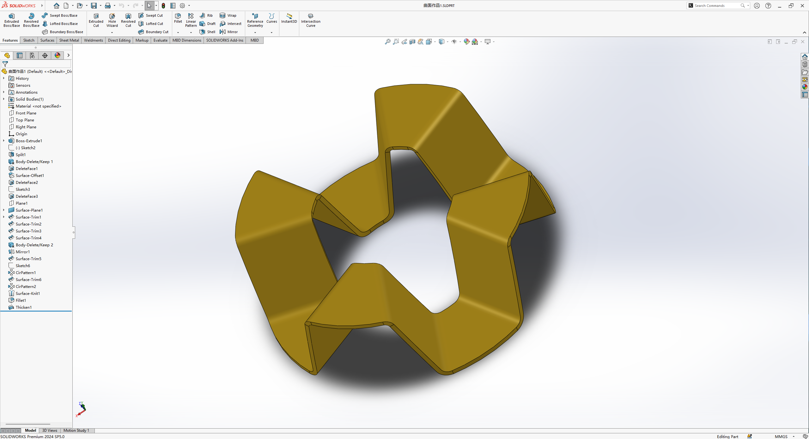</a> | **曲面造型-作品1** | 曲面造型 | [SLDPRT](./曲面造型-作品1.SLDPRT) [STEP](./该目录下的SW跨版本兼容模型/曲面造型-作品1.STEP) |
| 03 | <a href="./曲面造型-作品2.SLDPRT">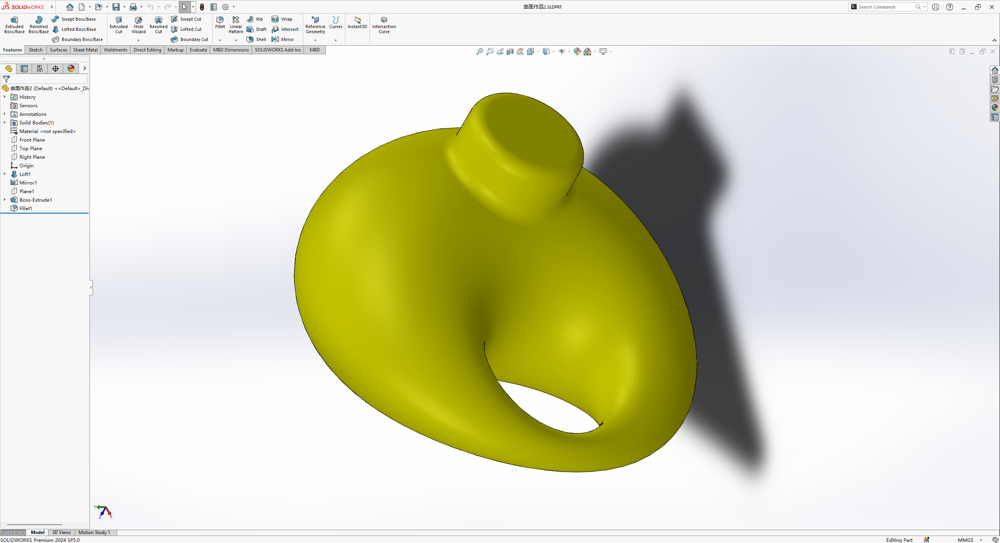</a> | **曲面造型-作品2** | 曲面造型 | [SLDPRT](./曲面造型-作品2.SLDPRT) [STEP](./该目录下的SW跨版本兼容模型/曲面造型-作品2.STEP) |
| 04 | <a href="./曲面造型-作品3.SLDPRT">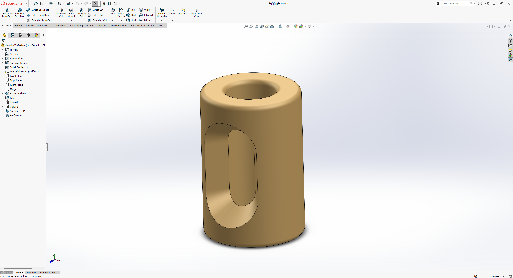</a> | **曲面造型-作品3** | 曲面造型 | [SLDPRT](./曲面造型-作品3.SLDPRT) [STEP](./该目录下的SW跨版本兼容模型/曲面造型-作品3.STEP) |
| 05 | <a href="./曲面造型-作品4-扭曲摆件.SLDPRT">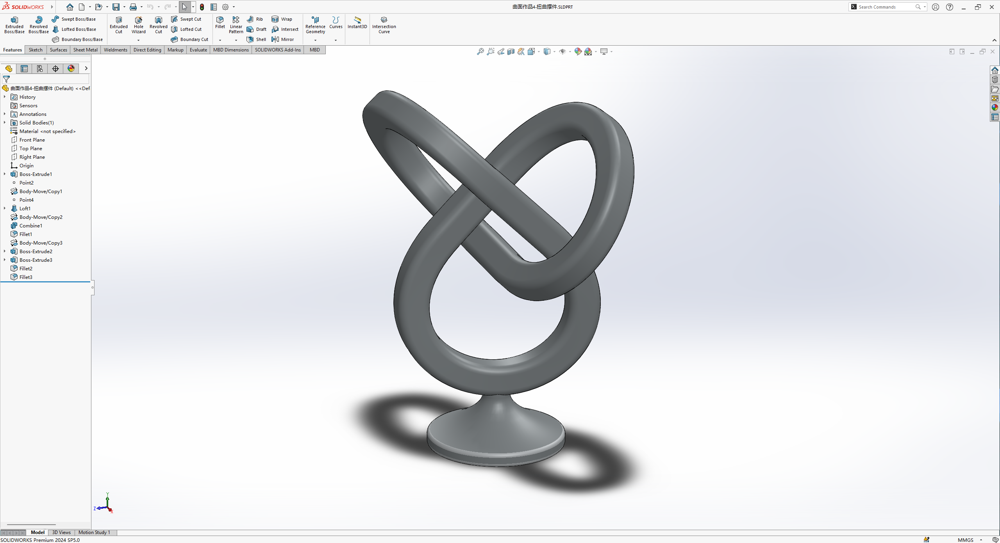</a> | **曲面造型-作品4-扭曲摆件** | 曲面造型 | [SLDPRT](./曲面造型-作品4-扭曲摆件.SLDPRT) [STEP](./该目录下的SW跨版本兼容模型/曲面造型-作品4-扭曲摆件.STEP) |
| 06 | <a href="./曲面造型-作品5-游戏币.SLDPRT">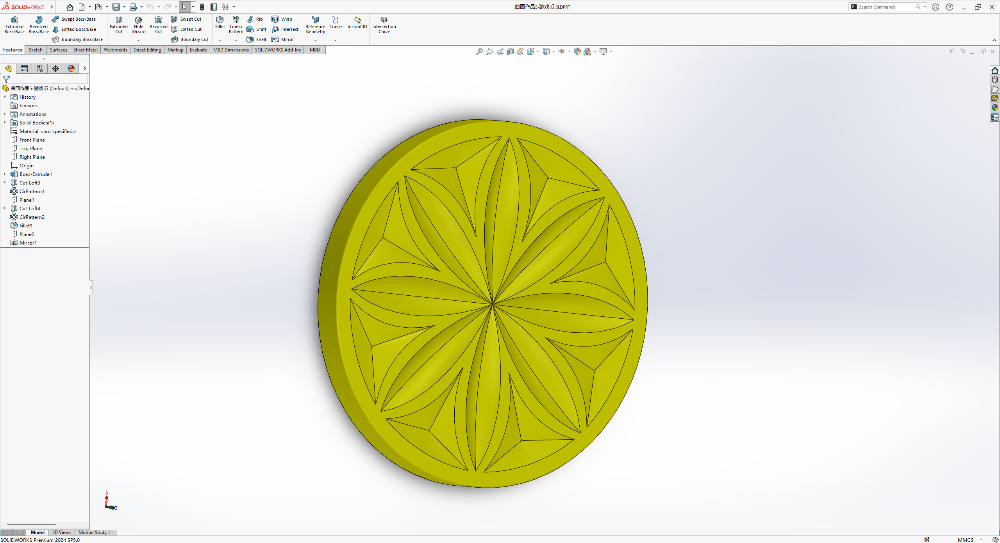</a> | **曲面造型-作品5-游戏币** | 曲面造型 | [SLDPRT](./曲面造型-作品5-游戏币.SLDPRT) [STEP](./该目录下的SW跨版本兼容模型/曲面造型-作品5-游戏币.STEP) |
| 07 |  | **曲面造型-作品6-勺子** | 曲面造型 | [SLDPRT](./曲面造型-作品6-勺子.SLDPRT) [STEP](./该目录下的SW跨版本兼容模型/曲面造型-作品6-勺子.STEP) |
| 08 | <a href="./曲面造型-瓜子.SLDPRT">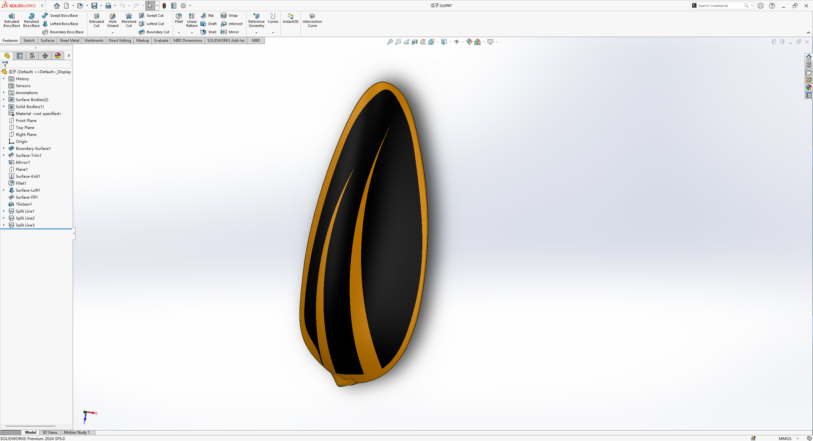</a> | **曲面造型-瓜子** | 曲面造型 | [SLDPRT](./曲面造型-瓜子.SLDPRT) [STEP](./该目录下的SW跨版本兼容模型/曲面造型-瓜子.STEP) |
| 09 | <a href="./曲面造型-麦克风网球.SLDPRT">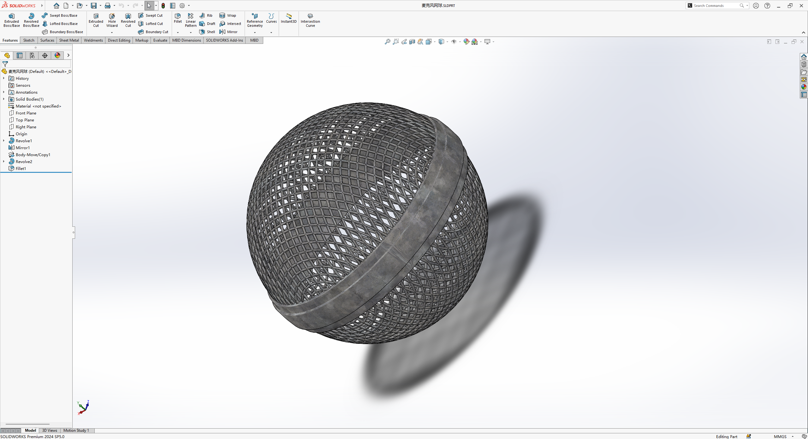</a> | **曲面造型-麦克风网球** | 曲面造型 | [SLDPRT](./曲面造型-麦克风网球.SLDPRT) [STEP](./该目录下的SW跨版本兼容模型/曲面造型-麦克风网球.STEP) |
| 10 | <a href="./钣金件-练习1.SLDPRT">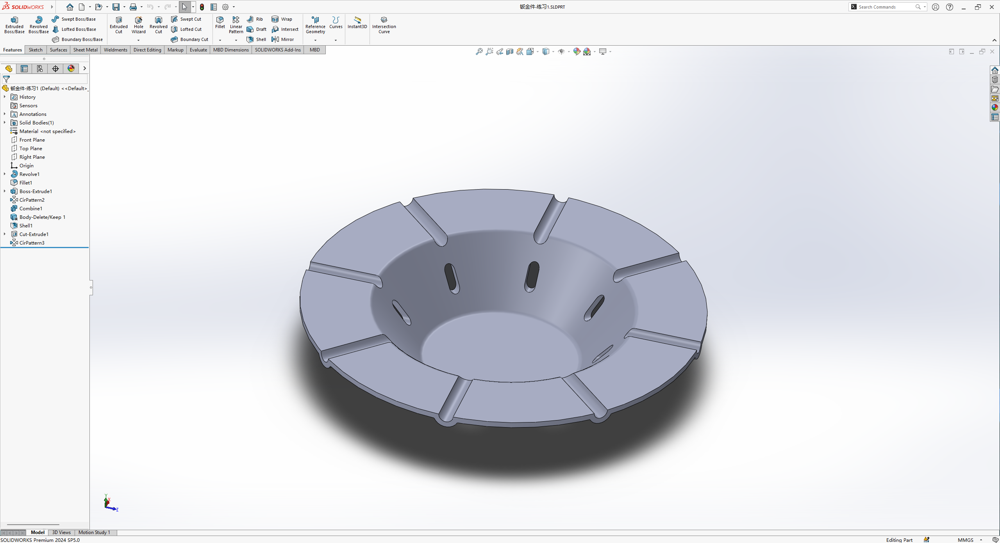</a> | **钣金件-练习1** | 钣金件 | [SLDPRT](./钣金件-练习1.SLDPRT) [STEP](./该目录下的SW跨版本兼容模型/钣金件-练习1.STEP) |
| 11 | <a href="./钣金件-练习2.SLDPRT">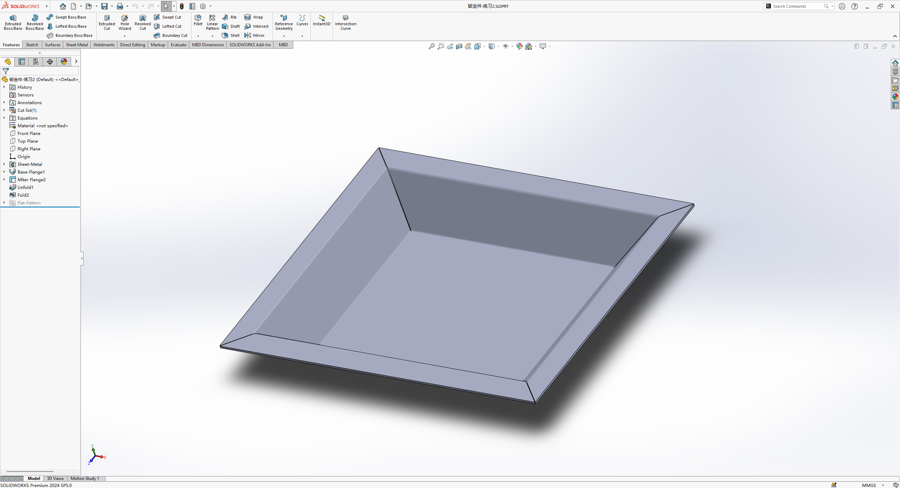</a> | **钣金件-练习2** | 钣金件 | [SLDPRT](./钣金件-练习2.SLDPRT) [STEP](./该目录下的SW跨版本兼容模型/钣金件-练习2.STEP) |
| 12 |  | **钣金件-餐盘** | 钣金件 | [SLDPRT](./钣金件-餐盘.SLDPRT) [STEP](./该目录下的SW跨版本兼容模型/钣金件-餐盘.STEP) |
| 13 | <a href="./工程机械-丝锥.SLDPRT">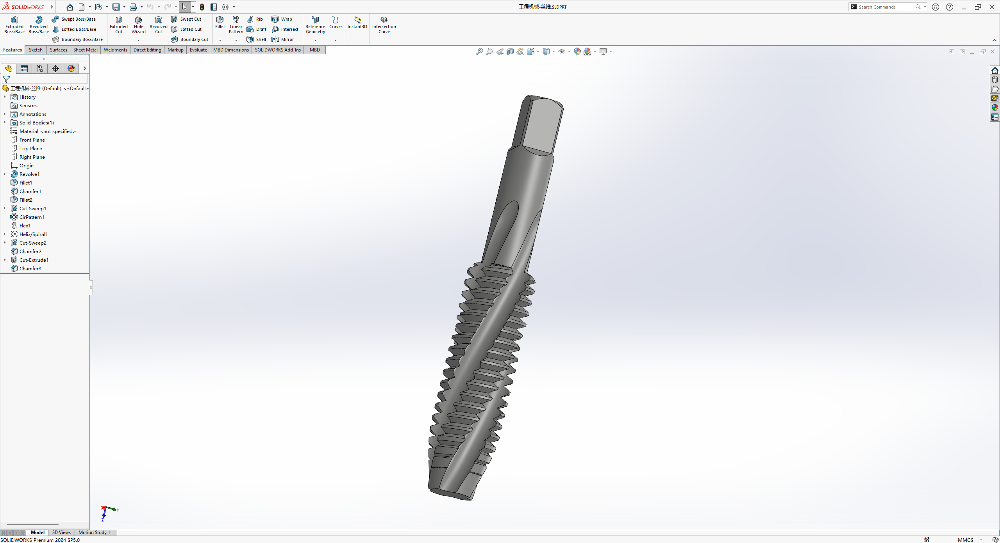</a> | **工程机械-丝锥** | 工程机械 | [SLDPRT](./工程机械-丝锥.SLDPRT) [STEP](./该目录下的SW跨版本兼容模型/工程机械-丝锥.STEP) |
| 14 |  | **工程机械-星型发动机主连杆** | 工程机械 | [SLDPRT](./工程机械-星型发动机主连杆.SLDPRT) [STEP](./该目录下的SW跨版本兼容模型/工程机械-星型发动机主连杆.STEP) |
| 15 | <a href="./五金件-啤酒瓶盖.SLDPRT">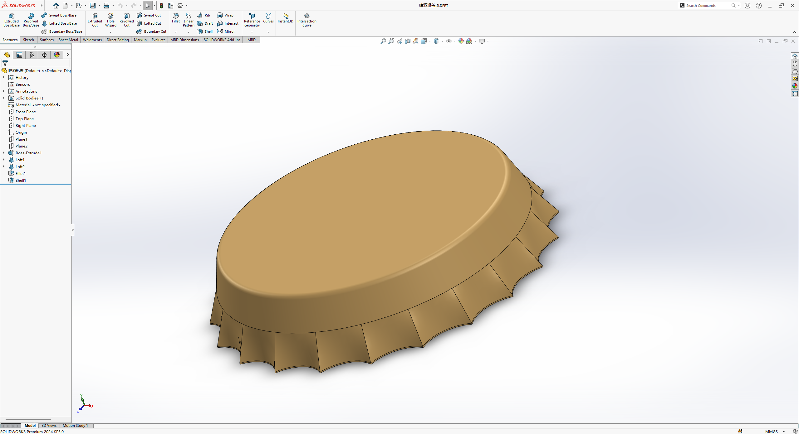</a> | **五金件-啤酒瓶盖** | 五金件 | [SLDPRT](./五金件-啤酒瓶盖.SLDPRT) [STEP](./该目录下的SW跨版本兼容模型/五金件-啤酒瓶盖.STEP) |
| 16 |  | **五金件-滚花螺母** | 五金件 | [SLDPRT](./五金件-滚花螺母.SLDPRT) [STEP](./该目录下的SW跨版本兼容模型/五金件-滚花螺母.STEP) |
| 17 |  | **五金件-螺旋刀** | 五金件 | [SLDPRT](./五金件-螺旋刀.SLDPRT) [STEP](./该目录下的SW跨版本兼容模型/五金件-螺旋刀.STEP) |
| 18 |  | **家电数码-吹风机出风口** | 家电数码 | [SLDPRT](./家电数码-吹风机出风口.SLDPRT) [STEP](./该目录下的SW跨版本兼容模型/家电数码-吹风机出风口.STEP) |
| 19 | <a href="./家电数码-灯泡.SLDPRT">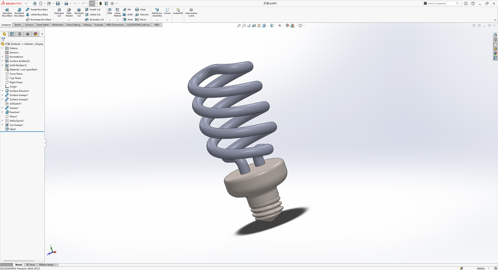</a> | **家电数码-灯泡** | 家电数码 | [SLDPRT](./家电数码-灯泡.SLDPRT) [STEP](./该目录下的SW跨版本兼容模型/家电数码-灯泡.STEP) |
| 20 |  | **家电数码-耳机** | 家电数码 | [SLDPRT](./家电数码-耳机.SLDPRT) [STEP](./该目录下的SW跨版本兼容模型/家电数码-耳机.STEP) |
| 21 | <a href="./家电数码-风扇.SLDPRT">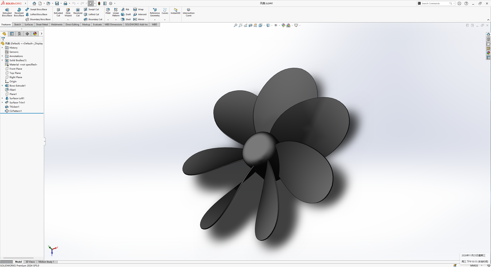</a> | **家电数码-风扇** | 家电数码 | [SLDPRT](./家电数码-风扇.SLDPRT) [STEP](./该目录下的SW跨版本兼容模型/家电数码-风扇.STEP) |
| 22 |  | **生活文创-握力器** | 生活文创 | [SLDPRT](./生活文创-握力器.SLDPRT) [STEP](./该目录下的SW跨版本兼容模型/生活文创-握力器.STEP) |
| 23 | <a href="./生活文创-烟灰缸.SLDPRT">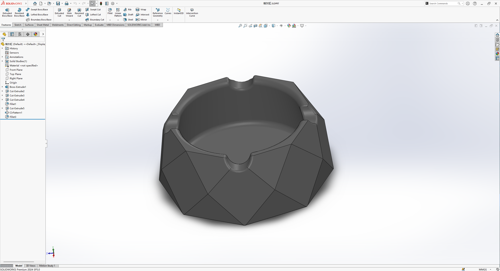</a> | **生活文创-烟灰缸** | 生活文创 | [SLDPRT](./生活文创-烟灰缸.SLDPRT) [STEP](./该目录下的SW跨版本兼容模型/生活文创-烟灰缸.STEP) |
| 24 |  | **生活文创-金色麦箍** | 生活文创 | [SLDPRT](./生活文创-金色麦箍.SLDPRT) [STEP](./该目录下的SW跨版本兼容模型/生活文创-金色麦箍.STEP) |
| 25 |  | **生活文创-骰子** | 生活文创 | [SLDPRT](./生活文创-骰子.SLDPRT) [STEP](./该目录下的SW跨版本兼容模型/生活文创-骰子.STEP) |

<!-- GALLERY:END -->

## 命名规范

根目录零件、预览图与其 STEP 兼容文件均采用 `类别前缀-模型名.扩展名` 格式，前缀取自以下受控词表：

| 前缀 | 适用范围 |
| --- | --- |
| `曲面造型-` | 自由曲面与造型练习 |
| `钣金件-` | 钣金成形件 |
| `工程机械-` | 机构与装备类零件 |
| `五金件-` | 标准件与金属制品 |
| `家电数码-` | 家电与消费电子外观件 |
| `生活文创-` | 日用品、玩具与文创件 |

`溜溜球项目/` 为独立装配体项目，其内部文件沿用项目内命名，不套用上述前缀。

## 说明

- SLDPRT/SLDASM 以 SolidWorks 2024 保存，低版本软件请使用 STEP 格式打开
- 补充新预览图后，在仓库根目录执行 `python tools/generate_gallery.py` 即可一键重建目录表
